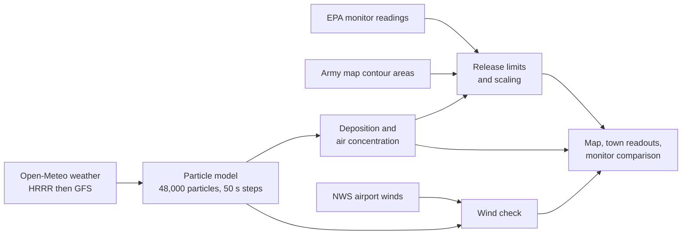

<div align="center">

# Iowa Lead Azide Detonation Dispersal Simulator

**A live, open model of where lead dust would travel if it had been released by the Army's controlled detonation at the Iowa Army Ammunition Plant on November 25, 2026.**

### [Open the simulator → iowa-lead-azide-dispersal.vercel.app](https://iowa-lead-azide-dispersal.vercel.app)

[](https://github.com/mil-orb/iowa-lead-azide-dispersal/actions/workflows/ci.yml)
[](https://iowa-lead-azide-dispersal.vercel.app)


[](LICENSE)


</div>

> [!IMPORTANT]
> **This is a scenario, not a record of what happened.** EPA reported no detection of airborne lead at its real-time monitors after the detonation. That is the observation. This model shows where lead dust would travel *if* an assumed amount had been released. No measurement shows that release occurred, and this is not a measured or confirmed exposure map. The only measurements in it are EPA's air monitor readings (and the airport winds used to check the forecast). The Army's maps are official planning forecasts, made before the detonation. For measured lead levels use EPA's [data viewer](https://experience.arcgis.com/experience/1ddcf8b9d8314971b00dac8893ae9cd6) and [response site](https://response.epa.gov/site/site_profile.aspx?site_id=17211). For official maps, the all-clear and instructions use the [Army's notification page](https://www.army.mil/asc#org-iowa-army-ammunition-plant). This project has no connection to the Army, EPA or any agency. Do not use its numbers for health decisions.

## Contents

- [What it is](#what-it-is)
- [What you can do with it](#what-you-can-do-with-it)
- [How it works](#how-it-works)
- [How it is checked](#how-it-is-checked)
- [The event, from public sources](#the-event-from-public-sources)
- [Data sources](#data-sources)
- [Limits](#limits)
- [Run it, test it, deploy it](#run-it-test-it-deploy-it)
- [Repository layout](#repository-layout)
- [Contributing](#contributing)
- [References](#references)

## What it is

At 9:00 AM CST on November 25, 2026 the U.S. Army detonated 68 drums of degraded lead azide in place at the Iowa Army Ammunition Plant in Middletown, Iowa. The Army published planning maps of where lead dust might land. EPA set up air monitors. Nobody published a tool the public could run.

This is that tool. It is a particle dispersion model that runs in your browser on live weather data. It takes an assumed release, shown beside every figure, and follows 48,000 model particles of different sizes for 48 hours. It puts EPA's real air readings first, next to its own scenario, and says plainly what it does not know.

It does not show what happened. EPA's monitors detected no airborne lead, and nothing published so far establishes that the release in the scenario occurred.

Two things it found on the day:

- **The dust that matters for distance is a tiny share of the lead.** Coarse dust, most of the mass, is on the ground within hours near the site. Lead particles small enough to count as PM2.5 stay airborne for days and, on the Nov 25 forecast, travel from Iowa to the Gulf coast in about 36 hours.
- **EPA's monitors read close to nothing.** Of the first 239 readings after the detonation, 223 were zero and the highest was 0.010 µg/m³. EPA's own short-term screening level is 32 µg/m³.

### What is modeled, what is measured

| On the page | What it is |
|---|---|
| Particles, coloured deposit, outlines, town figures, plume summary | **Modeled.** Potential, from weather data and assumptions. Not confirmed |
| EPA monitor squares, the EPA readings table and chart | **Measured**, by EPA |
| Airport winds in the wind check | **Measured**, by the National Weather Service |
| Army deposition maps (images) | **Official forecast** from the Army's planning model, made before the detonation |
| EPA's other 39 stations | Positions only. No readings published |

## What you can do with it

| | |
|---|---|
| **Check a town in the scenario** | Pick any of 61 towns from Iowa to the Gulf coast. See when dust would arrive if the assumed amount had been released, with the assumed release and the definition of arrival shown beside it. Figures are rounded and describe an area, because the inputs do not support town-level precision. |
| **Play the timeline** | Scrub or play 48 hours. Watch coarse dust fall out and fine dust keep going. |
| **See EPA's readings** | A table and chart for each of EPA's four real-time lead monitors, read live. The reading nearest the displayed time shows beside each monitor on the map. All 43 of EPA's listed sampling stations are drawn, in the colours of EPA's own legend (monitor squares green under 32 µg/m³, yellow at or above). |
| **Compare with the Army** | The Army's newest deposition maps load next to the model, and the model's deposition is scored against the Army's two contour areas. |
| **Check the forecast** | The model's wind is compared with National Weather Service observations at eight airports for the hours already past. |
| **Change the assumptions** | Release amount, cloud height, particle size, material and turbulence are all adjustable. |

## How it works



**Weather.** Hourly data from [Open-Meteo](https://open-meteo.com/): NOAA's 3 km HRRR model for the first day, then GFS. Winds at eight heights, boundary layer height, precipitation, solar radiation and cloud cover on a 154-point grid at 0.6° (36.5 to 42.5°N, 96.5 to 88.7°W), plus a wide 168-point grid at 1.5° (27 to 43.5°N, 98.5 to 79°W) for dust that leaves the main grid. Fetched on every load and every 30 minutes, through a shared copy at most 10 minutes old. Nothing is bundled with the page.

**Particles.** 48,000 particles in ten size bins from 0.2 to 80 µm, run in a background worker after a quick 12,000 particle pass. Each carries a share of the lead mass.

**Physics.**

| Process | Method |
|---|---|
| Transport | Wind interpolated in space, time and the logarithm of height. Log law below 10 m |
| Settling | Stokes with Cunningham slip and Schiller-Naumann drag. Air viscosity, density and mean free path from forecast temperature and pressure |
| Stability | EPA solar radiation method by day, Turner's key at night (EPA-454/R-99-005) |
| Horizontal spread | Correlated random walk. Intensity from Gifford (1976) times the 10 m wind. Memory time set against Draxler (1976) |
| Vertical mixing | Random walk reflecting at the ground and the boundary layer top |
| Dry deposition | Resistance model (Slinn 1982, Seinfeld and Pandis 2016) |
| Wet deposition | Washout rate from Baklanov and Sørensen (2001) |

**Fine means aerodynamic.** Air monitors and the terms PM10 and PM2.5 select on aerodynamic diameter. Lead oxide is 9.5 times denser than water, so PM10 means about 3 µm physical and under, and PM2.5 about 0.8 µm.

**How much lead.** Nobody has published the amount released, so the model bounds it three ways and shows all three:

1. **EPA monitors.** The dose the monitors recorded above their pre-detonation average, plus two standard errors of the background noise, divided by the modeled dose per kilogram at the same monitors. This is a limit, and it is repeated with the detonation point moved 3 km in four directions, and to one more candidate point for the magazine taken from another public simulator, because that point is not public.
2. **Army planning map.** The release at which modeled deposition covers the same areas as the map's two contours (29 sq mi above 100 µg/ft², 186 sq mi above 5 µg/ft²). This is the high case and the default.
3. **1977 reference.** The 25% airborne fraction from an unmitigated detonation the Army cited.

## How it is checked

| Check | Result |
|---|---|
| Mass conservation | Airborne + deposited + left the map = released, to rounding error |
| Settling speed | Matches hand calculations for 1 µm and 10 µm lead |
| Stability classes | Match EPA's published tables cell for cell |
| Wind profile | Reproduces a logarithmic profile within 3% between and below data levels |
| Advection | Cloud centre within 2% of wind speed × time |
| Vertical mixing | A dust layer mixes to an even profile and stays even |
| Deposition rate | Airborne mass decays at the analytic rate (0.48 against 0.46 after two hours) |
| Crosswind spread | Within 7% of Draxler's 1976 curve from one to three hours |
| Winds aloft | Within 8° and about 2 m/s of the Davenport weather balloon at 925 and 850 hPa, 12 UTC Nov 25 |
| Surface winds | 12° average direction error and 0.5 m/s low across 155 airport readings in the first five hours |
| Numerical convergence | Fitted release changes under 10% with a new seed, four times the particles, or half the time step |
| Unsourced constants | Halving and doubling each moved arrival times by 15 minutes or less |

The first eight are automated tests in [`test/core.test.js`](test/core.test.js) and run on every push. The rest were measured on the Nov 25 weather.

## The event, from public sources

| Parameter | Value used | Source |
|---|---|---|
| Time | 9:00 AM CST (15:00 UTC), November 25, 2026 | Army advisory and news reports |
| Material | 68 drums of degraded lead azide, more than 9,700 lb net explosive weight (the Environmental Assessment says 9,500 lb) | Army statements |
| Lead in the stockpile | About 3,130 kg. Lead azide, Pb(N₃)₂, is 207.2 / 291.24 = 71.1% lead | Atomic weights |
| What the lead becomes | Fine lead oxide dust, in a cloud mostly of nitrogen, sand, soil and water vapor | Army modeling, as reported |
| Method | Two earth-covered magazines detonated at once, in place, with donor explosives | Army Environmental Assessment |
| Mitigation | Sand-filled barriers about two stories high, a water wall of more than 100,000 gallons, foam, gel blocks, misting, blast vented south and southwest | Army statements and Environmental Assessment |
| Share of lead released | Not published. A 1977 detonation of about 7,000 lb with no mitigation put about 25% in the air | Army briefing |
| Location | Not published. Near the headwaters of Long Creek in the western half of the plant. The model uses 40.802°N, 91.275°W, where the line of EPA monitors crosses the creek | Environmental Assessment, EPA monitor positions, OpenStreetMap |
| Go/no-go weather | Daylight, no precipitation, surface wind under 15 mph, no temperature inversion | Environmental Assessment |
| Observed at Burlington airport, 8:53 to 9:53 AM | Wind from 050° at 8 to 13 knots, clear below 12,000 ft, 1 °C | National Weather Service |
| Planning model | DTRA (through IMAAC). Deposition areas of 29 and 186 sq mi at 100 and 5 µg/ft², which the map legend calls EPA's limits for lead dust on window sills and floors | Army deposition map, 8:00 AM Nov 25 |
| Air measurements | Four EPA real-time lead monitors, 5 to 43 km southwest. EPA reported no detection of airborne lead | EPA data viewer and statements |
| Soil cleanup level | 200 parts per million at residential properties | Army statement |

## Data sources

| Data | Source | Refresh |
|---|---|---|
| Forecast weather | [Open-Meteo](https://open-meteo.com/) (NOAA HRRR and GFS), CC BY 4.0 | Every load and every 30 minutes |
| Lead in air | [EPA Region 7 data viewer](https://experience.arcgis.com/experience/1ddcf8b9d8314971b00dac8893ae9cd6), four real-time monitors | Every load and every 30 minutes |
| Sampling station positions | EPA Region 7, same viewer | Every load |
| Official deposition maps | U.S. Army, through the plant's [DVIDS feed](https://www.dvidshub.net/unit/IAAAP) | Every load and every 30 minutes |
| Observed surface wind | U.S. National Weather Service, api.weather.gov | Every load and every 30 minutes |
| Basemap | © [OpenStreetMap](https://www.openstreetmap.org/copyright) contributors | Tiles on demand |

## Limits

**What is unknown**

- How much lead left the site. The three bounds above span roughly 5 to 780 kg.
- Where exactly the magazines were. The model's point is inferred and could be off by a few km.
- Whether EPA's monitors have PM10 inlets. The monitor limit assumes they do.
- The particle sizes and the height of the first dust cloud. The defaults (30 µm median, 300 m) are the pair that best reproduces both Army contours (26 and 212 sq mi against 29 and 186).

**What the monitors cannot tell you**

- Four monitors near the ground only see fine dust that passes over them. Coarse dust that fell near the site, or a plume that passed overhead or to one side, would not register. On Nov 25 a 3 km shift in the detonation point was enough for the modeled plume to miss all four.

**What the model leaves out**

- Forecast uncertainty. One forecast is used, with no ensemble, so the far end of the track (a day or more out) is the least certain. Hours after the fetch time are forecast and will shift.
- Fine detail. The main weather grid is about 50 by 65 km and the wide one about 150 km. Terrain, river valleys, fronts and local wind shifts are smoothed.
- Vertical air motion, resuspension of settled dust, and the blast and buoyant rise in the first minutes.
- Particle shape. Lead oxide is treated as solid spheres. Fresh fume forms loose aggregates that fall more slowly, and lead stuck to sand or soil travels with those larger grains.
- Snow. Precipitation washes dust out at one rate fitted for rain and for particles under 2.8 µm.
- Other possible emissions (hydrochloric acid, organic combustion products).
- Hot spots. Town readouts are averages over a 20 km radius.

**Running limits**

- Weather comes through a small function that holds Open-Meteo's answer for 10 minutes so visitors share one fetch. When that fails (Open-Meteo often limits Vercel's shared addresses) the browser asks Open-Meteo directly, which allows about one load a minute and eight an hour per visitor. The page retries on its own.

## Run it, test it, deploy it

There is no build step and nothing to install.

```bash
git clone https://github.com/mil-orb/iowa-lead-azide-dispersal
```

```bash
python -m http.server 8765 --directory iowa-lead-azide-dispersal
```

Open http://localhost:8765. The model and map work from any static server. The two functions in `api/` only run on Vercel, so locally the Army panel shows its fallback links and weather comes straight from Open-Meteo.

Run the tests (Node 20 or newer, no packages):

```bash
node --test test/core.test.js
```

Deploy your own copy:

```bash
vercel deploy --prod
```

## Repository layout

| Path | What it is |
|---|---|
| [`index.html`](index.html) | The whole app: page, styles, the model (`<script id="core">`, no DOM access) and the interface |
| [`api/army-maps.js`](api/army-maps.js) | Reads the plant's DVIDS feed and returns the newest Army map images |
| [`api/weather.js`](api/weather.js) | Forwards the page's Open-Meteo request so the edge can share one copy for 10 minutes |
| [`test/core.test.js`](test/core.test.js) | Offline tests of the model on made-up weather |
| [`AGENTS.md`](AGENTS.md) | Rules and a code map for coding assistants |
| [`CHANGELOG.md`](CHANGELOG.md) | What changed in each version, including each audit |
| [`CITATION.cff`](CITATION.cff) | How to cite this model |

## Contributing

Corrections to the physics and comparisons with measured data are the most useful help. Read [CONTRIBUTING.md](CONTRIBUTING.md) first. Report security problems privately through [SECURITY.md](SECURITY.md).

## References

Where each formula and constant in the model comes from. Entries marked † were checked against an online record when this list was written. The rest are standard references cited from the literature, so check volume and page numbers before reusing them formally.

**Transport and turbulence**

- Stability class: † U.S. EPA (2000). *Meteorological Monitoring Guidance for Regulatory Modeling Applications*, EPA-454/R-99-005. Table 6-7 (solar radiation method, used by day) and Tables 6-4 and 6-6 (Turner's key, used at night). The tests check the model against both tables. Background: Pasquill, F. (1961). The estimation of the dispersion of windborne material. *Meteorological Magazine*, 90, 33-49. Turner, D. B. (1964). A diffusion model for an urban area. *Journal of Applied Meteorology*, 3, 83-91.
- Lateral turbulence intensity for each class (σθ of 25, 20, 15, 10, 5 and 2.5 degrees for A to F): Gifford, F. A. (1976). Turbulent diffusion-typing schemes: a review. *Nuclear Safety*, 17(1), 68-86.
- Vertical turbulence intensities: about half the lateral ones, a common rule of thumb with no single source. For class D they give σw of about 1.0 times the friction velocity, a little under the neutral surface-layer ratio of about 1.25 to 1.3 in Panofsky, H. A., and Dutton, J. A. (1984). *Atmospheric Turbulence*. Wiley.
- Growth of crosswind spread with travel time, used to set the 330 s memory time and tested in `test/core.test.js`: † Draxler, R. R. (1976). Determination of atmospheric diffusion parameters. *Atmospheric Environment*, 10(2), 99-105. https://doi.org/10.1016/0004-6981(76)90226-2
- Random-walk particle models and the requirement that a well-mixed layer stays well mixed: Thomson, D. J. (1987). Criteria for the selection of stochastic models of particle trajectories in turbulent flows. *Journal of Fluid Mechanics*, 180, 529-556.
- General design (particles carrying mass, a shallow layer for dry deposition, mixing capped at the boundary layer): Stohl, A., Forster, C., Frank, A., Seibert, P., and Wotawa, G. (2005). Technical note: The Lagrangian particle dispersion model FLEXPART version 6.2. *Atmospheric Chemistry and Physics*, 5, 2461-2474. Stein, A. F., Draxler, R. R., Rolph, G. D., Stunder, B. J. B., Cohen, M. D., and Ngan, F. (2015). NOAA's HYSPLIT atmospheric transport and dispersion modeling system. *Bulletin of the American Meteorological Society*, 96, 2059-2077.
- Friction velocity from the 10 m wind, and interpolation of wind between levels in the logarithm of height (logarithmic wind profile): Stull, R. B. (1988). *An Introduction to Boundary Layer Meteorology*. Kluwer.

**Particles**

- Stokes settling, the Cunningham slip correction (constants 1.257, 0.4, 1.1), Brownian diffusivity, and the resistance form of dry deposition velocity: Seinfeld, J. H., and Pandis, S. N. (2016). *Atmospheric Chemistry and Physics: From Air Pollution to Climate Change* (3rd ed.). Wiley. Chapters 9 and 19.
- Surface-layer resistance (Schmidt and Stokes number terms): Slinn, W. G. N. (1982). Predictions for particle deposition to vegetative canopies. *Atmospheric Environment*, 16(7), 1785-1794.
- Drag correction for larger particles: Schiller, L., and Naumann, A. (1933). Über die grundlegenden Berechnungen bei der Schwerkraftaufbereitung. *Zeitschrift des Vereines Deutscher Ingenieure*, 77, 318-320.
- Lognormal size distributions by mass, and aerodynamic diameter (physical diameter times the square root of density relative to water, which is what PM10 and PM2.5 inlets select on): Hinds, W. C. (1999). *Aerosol Technology* (2nd ed.). Wiley.
- Air viscosity from temperature (Sutherland's law, 1.716×10⁻⁵ Pa·s at 273.15 K, constant 110.4 K) and mean free path scaled from 66.5 nm at 20 °C and 1 atm: Seinfeld and Pandis (2016), chapter 9.
- Rain washout rate, 8.4×10⁻⁵ × (mm/h)^0.79 per second: † Baklanov, A., and Sørensen, J. H. (2001). Parameterisation of radionuclide deposition in atmospheric long-range transport modelling. *Physics and Chemistry of the Earth (B)*, 26(10), 787-799, as tabulated in Wang, X., Zhang, L., and Moran, M. D. (2014). *Geoscientific Model Development*, 7, 799-819. Their fit is for particles under 2.8 µm. This model applies it to every size, which understates washout of coarse dust.

**Data**

- Weather: † Zippenfenig, P. (2023). Open-Meteo.com Weather API [Computer software]. Zenodo. https://doi.org/10.5281/ZENODO.7970649. Data under CC BY 4.0. A request naming NOAA's HRRR model returned the same values as the default for the first 24 hours, so that is what the first day runs on.
- Surface wind observations for the forecast check: U.S. National Weather Service, api.weather.gov.
- One-off check of winds aloft: Davenport, Iowa radiosonde at 12 UTC on Nov 25, 2026, from the Iowa Environmental Mesonet archive. Observed 925 hPa wind from 90° at 7.7 m/s against the model's 82° at 8.0 m/s; 850 hPa from 95° at 5.7 m/s against 92° at 7.9 m/s.
- Air monitor readings: U.S. EPA Region 7, Iowa Army Ammunition Plant Response Data Viewer. https://experience.arcgis.com/experience/1ddcf8b9d8314971b00dac8893ae9cd6
- Planning-case deposition areas and dispersion time markers: U.S. Army, Deposition Maps as of 8:00 AM (CST), November 25, 2026. https://www.army.mil/article/297086
- Lead content of lead azide, Pb(N₃)₂: 207.2 / 291.24 = 71.1% by mass, from standard atomic weights.
- Event facts: U.S. Army, Environmental Assessment for Lead Azide Risk Mitigation at the Iowa Army Ammunition Plant (IAAAP-EA-2026-01); Army public safety advisory of Nov 24, 2026 (https://www.army.mil/article/297039); the Army's Environmental Sampling and Analysis Plan in EPA's permit record (https://response.epa.gov/site/doc_list.aspx?site_id=17211); Army briefing statements as reported by KCCI, Valley News Live and PBS NewsHour on Nov 24 and 25, 2026.
- Creek positions used to place the detonation point: OpenStreetMap contributors.

**Not from a source**

These are this project's own choices: the 150 s vertical time scale and the 0.5 m²/s mixing rate above the boundary layer, the 0.3 factor on horizontal turbulence above the boundary layer (halving and doubling each of these moved arrival times by 15 minutes or less on the Nov 25 weather), the 30 m deposition layer, the 0.1 m surface roughness, the 1.5 km and 50 m monitor comparison volume, the 3 km detonation-point shifts, and the default cloud top and particle sizes.

## Credits and license

Weather by [Open-Meteo.com](https://open-meteo.com/) (NOAA HRRR and GFS). Basemap © OpenStreetMap contributors. Map library: Leaflet. Air readings: U.S. EPA. Official maps: U.S. Army through DVIDS. Surface observations: U.S. National Weather Service.

[MIT license](LICENSE). To cite the model, see [CITATION.cff](CITATION.cff).
