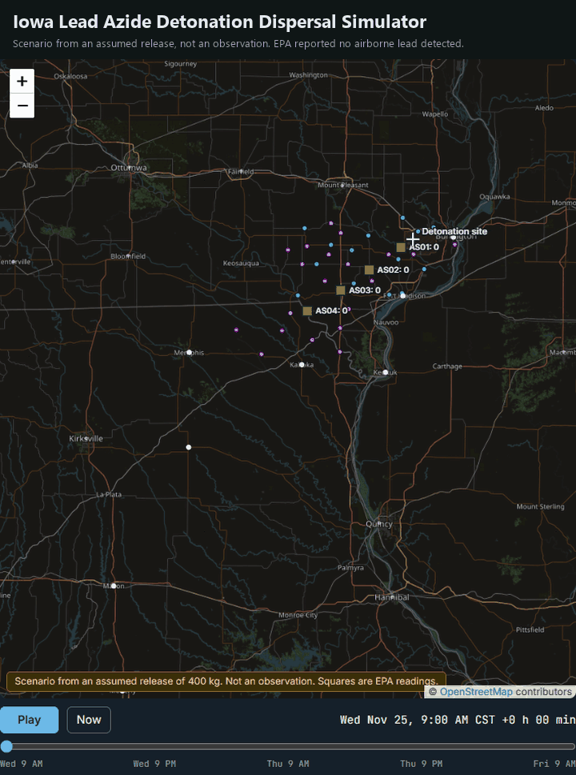

# Iowa Lead Azide Detonation Dispersal Simulator

[](https://github.com/mil-orb/iowa-lead-azide-dispersal/actions/workflows/ci.yml)


[](LICENSE)

**Live: https://iowa-lead-azide-dispersal.vercel.app**

A particle model of where lead dust went after the U.S. Army's controlled detonation of degraded lead azide at the Iowa Army Ammunition Plant (Middletown, Iowa) at about 9:00 AM CST on November 25, 2026. It runs in your browser on live weather data and follows the dust for 48 hours.



**It is a model estimate. It measures nothing.** For measured lead levels use EPA's [data dashboard](https://experience.arcgis.com/experience/1ddcf8b9d8314971b00dac8893ae9cd6) and [response site](https://response.epa.gov/site/site_profile.aspx?site_id=17211). For official maps and instructions use the [Army's notification page](https://www.army.mil/asc#org-iowa-army-ammunition-plant). This project has no connection to the Army, EPA or any agency.

## What it does

- Fetches hourly winds at eight heights, boundary layer height, precipitation, sunlight and cloud cover from [Open-Meteo](https://open-meteo.com/) on a 154-point grid (36.5 to 42.5°N, 96.5 to 88.7°W), plus a finer 99-point grid over the first 150 km of the plume track. Fetched on every load and every 30 minutes, through a shared copy at most 10 minutes old.
- Moves 48,000 particles in eight size bins (0.3 to 80 µm) in 50 second steps, in a background worker. A quick 12,000 particle pass shows first.
- Settling: Stokes with slip and drag corrections. Turbulent spread: Pasquill class intensities times the 10 m wind, with crosswind growth matched to Draxler (1976). Dry deposition: a resistance model. Wet deposition: rain washout.
- Reads EPA's four real-time lead monitors along the plume path, live, and turns them into a limit on the release: the dose they recorded above their pre-detonation average, plus two standard errors of the background noise, divided by the modeled dose per kilogram at the same monitors. On the morning of the detonation they showed no clear signal above background. For a detonation at the assumed point that caps the release at a few kilograms.
- The detonation point is not public and the plant is several km across. The page repeats the limit with the point moved 3 km in four directions and uses the largest. On Nov 25 two of those plumes passed beside the monitors entirely, so the monitors could not rule out the Army planning case, and the page shows that high case by default.
- Can instead scale the release to the Army's pre-detonation map (29 sq mi above 100 µg/ft², 186 sq mi above 5 µg/ft²), which implies several hundred kilograms. That map is a planning forecast and is the high case. The page shows both.
- Pick any of 41 towns to see when the modeled dust arrives, the peak in the air and what is left on the ground.
- Shows the Army's newest deposition maps next to the model, read from the plant's public DVIDS feed.

## Run it

There is no build step and no dependency to install.

```bash
git clone https://github.com/mil-orb/iowa-lead-azide-dispersal
```

```bash
python -m http.server 8765 --directory iowa-lead-azide-dispersal
```

Open http://localhost:8765. The model and the map work from any static server. The two functions in `api/` (the Army map feed and the shared weather copy) only run on Vercel. Locally the Army panel shows its fallback links and weather comes straight from Open-Meteo.

Tests (Node 20 or newer, no packages). They cover mass conservation, settling speeds, vertical mixing to an even profile, decay of airborne mass against the analytic rate, and crosswind spread against Draxler's curve:

```bash
node --test test/core.test.js
```

Deploy your own copy with `vercel deploy --prod`.

## Limits

- Nobody has published how much lead left the site. The monitor limit only constrains fine dust (10 µm and under, an assumed inlet size) that passed four points near the ground. Coarse dust that fell near the site, or a plume that passed overhead or to one side, would not show up, so more could have left than the limit says.
- The cloud top (300 m), the particle sizes (30 µm median) and the detonation point are assumptions. The first two were chosen because they come closest to reproducing both Army contours (28 and 203 sq mi against 29 and 186).
- Hours after the fetch time are forecast and will shift.
- The weather grid is about 50 by 65 km. Terrain, river valleys and local wind shifts are missing.
- No chemistry, no resuspension of settled dust, no blast or buoyancy model for the first minutes.
- Town readouts are averages over a 20 km radius and will miss hot spots.
- Weather comes through a small function that holds Open-Meteo's answer for 10 minutes, so all visitors share one fetch. When that fails (Open-Meteo often limits Vercel's shared addresses) the browser asks Open-Meteo directly, which allows about one load a minute and eight an hour per visitor. The page retries on its own.
- Do not use these numbers for health decisions.

## Credits

Weather: Open-Meteo (NOAA HRRR and GFS). Basemap: © OpenStreetMap contributors. Map library: Leaflet. Official maps: U.S. Army via DVIDS.

MIT license. See [LICENSE](LICENSE).
